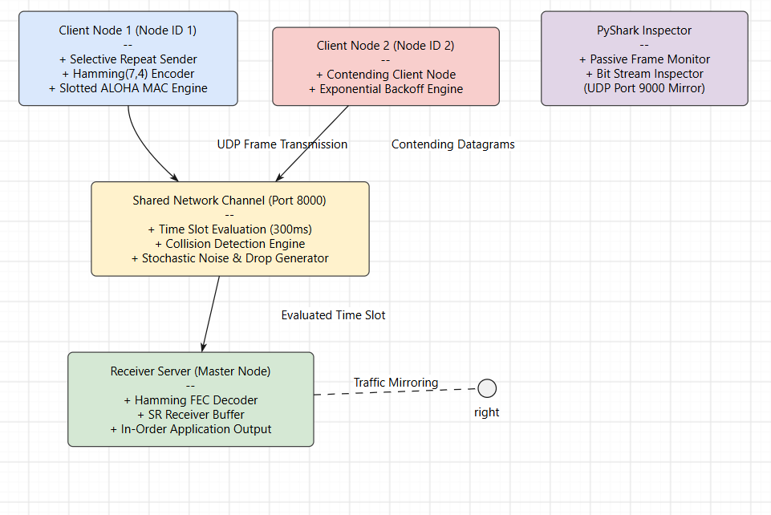

# Overview  

A C++ and Python simulation of custom Data Link Layer (Layer 2) protocols operating over a BSD Client-Server socket architecture. 

The project demonstrates fundamental network communication mechanisms, including medium access control (Slotted ALOHA), forward error correction (Hamming 7,4 Code), flow control (Selective Repeat ARQ), stochastic channel noise/drop models, and in-order application layer frame delivery.

---

## Key Features

1. **Packet Movement & Framing**: Serialization of raw application payloads into structured Data Link frames sent across UDP sockets (`AF_INET`).
2. **In-Order Delivery**: Receiver-side reordering buffer ensuring out-of-order packets are held until missing sequence numbers arrive before delivering contiguous data to the application.
3. **Error Control (Hamming FEC)**: Implementation of Hamming(7,4) bitwise encoding and syndrome calculation capable of automatically detecting and correcting single-bit channel errors.
4. **Flow Control (Selective Repeat ARQ)**: Sender and receiver sliding windows with individual packet retransmission timers and selective ACKs.
5. **Multiple Access (Slotted ALOHA)**: Synchronized time slot evaluation with collision detection and binary exponential backoff for contending client nodes.
6. **Stochastic Channel Model**: Probability-driven channel module (`StochasticChannel.hpp`) introducing random bit flips and packet drops during physical transit.

---

## Implementation Overview  
**Slotted ALOHA**: Time is divided into discrete slots of 300 ms. If multiple client datagrams reach server.cpp within the same time window, a collision is flagged, all frames in that slot are dropped, and clients initiate exponential backoff.  

**Hamming(7,4) Code**: Every 4 bits of payload data are encoded into a 7-bit codeword containing 3 parity bits. Upon frame receipt, the server calculates syndrome bits to correct any single-bit error introduced by StochasticChannel.hpp.  

**Selective Repeat ARQ**: Frames carry explicit sequence numbers. The receiver sends a selective ACK for each valid frame. Unacknowledged frames trigger an independent client-side timer expiration and retransmission without resending already-acknowledged frames.  

## Project Architecture    

## Directory Layout

``` 
dll-simulation/
├── include/                      # C++ Header Files
│   ├── Frame.hpp                 # Frame structure and byte serialization
│   ├── HammingCode.hpp           # Hamming(7,4) encoder/decoder
│   ├── SelectiveRepeat.hpp       # Sliding window & retransmission timers
│   ├── SlottedALOHA.hpp          # Node state & exponential backoff
│   └── StochasticChannel.hpp     # Probabilistic channel noise/drop generator
├── src/                          # Core Source Code
│   ├── client.cpp                # Contending Client application entry point
│   └── server.cpp                # Receiver Server & Channel Master entry point
├── scripts/                      # External Utilities
│   └── pyshark_inspector.py     # Live packet inspection script
├── build/                        # Compiled executable binaries (gitignored)
├── app.py                        # Streamlit web visualization dashboard
├── main.py                       # CLI execution script & orchestrator
├── requirements.txt              # Python dependencies
└── README.md                     # Documentation  
```   
## Prerequisites  
**C++ Compiler**: g++ supporting C++17 or later.  

**Python**: Version 3.8+  

**Wireshark** / TShark (Optional, required only for live PyShark packet sniffing).      

## Installation
1. Clone the repository 
``` 
git clone [https://github.com/adisri-ai/Slotted-ALOHA-Hamming-Code-DLL-Implementation](https://github.com/adisri-ai/Slotted-ALOHA-Hamming-Code-DLL-Implementation)
```  
## Execution Methods  
1. **Method 1 : Web UI (Streamlit)**   
    Run the following command:    
    ``` 
    streamlit run app.py  
    ``` 
2. **Method 2: Command Line Orchestrator**  
    Run the following command:   
    ``` 
    python3 main.py  
    ``` 
